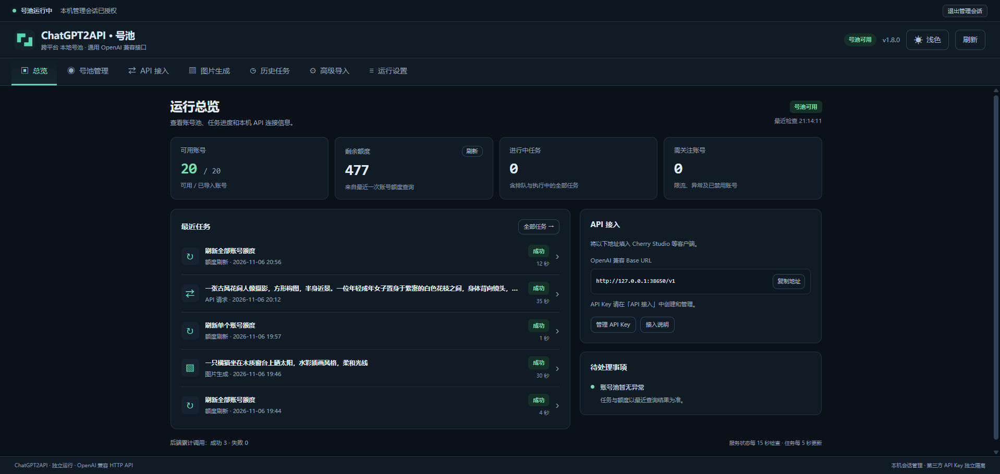

# ChatGPT2API 本机号池

这是一个在自己电脑上运行的账号管理工具。启动后，你可以在浏览器里管理 ChatGPT 账号、查看额度、生成图片，也可以让 Cherry Studio 等软件通过它调用接口。

默认使用石墨灰和青绿色的暗色主题。右上角可以切换浅色，程序会记住当前浏览器的选择。



## 第一次使用

### 1. 安装 Node.js

从 [Node.js 官网](https://nodejs.org/en/download)下载安装适合自己系统的 **LTS 版本**，要求 **20.11 或更高版本**。

安装完成后，重新打开终端。你只需要手动安装 Node.js，不需要先运行 `npm install`，也不用安装 Docker。

**程序仍然需要 Python 来运行后端，但启动脚本会自动准备，无需你手动安装。** Node.js 负责启动程序和管理页面；Python 负责账号池及实际接口服务。首次启动时，会优先使用电脑上已有的兼容 Python；如果没有，则自动下载 Python 3.13，并在程序的数据目录中安装所需依赖。以后启动会复用这个环境，因此首次启动需要联网。

### 2. 解压整个项目

把项目完整解压到一个固定文件夹。不要在压缩包里直接启动，也不要只复制启动脚本。

### 3. 启动程序

| 系统 | 启动方式 |
| --- | --- |
| macOS / Linux | 在项目文件夹打开终端，运行 `sh ./start.sh`（[查看脚本](start.sh)） |
| Windows | 双击 [start-windows.bat](start-windows.bat) |

脚本会检查 Node.js、准备管理页面、检查 Python 环境，然后启动服务并自动打开浏览器。macOS、Linux 和 Windows 都会执行相同的 Python 检查。**启动后请保留终端窗口。**

启动时，终端会显示 Python 的版本、路径和检查结果：

| Python 检查提示 | 含义与后续操作 |
| --- | --- |
| 已有环境可用 | 已保存的 Python 可以运行，关键依赖文件齐全，继续复用 |
| 检测到兼容的 Python | 找到了 Python 3.13 或更高的 3.x 版本，程序会用它创建隔离环境并安装依赖 |
| 未检测到兼容的 Python | 没有安装、版本太旧或无法运行；程序会在需要时自动下载 Python 3.13，无需手动安装 |
| 已有环境需要修复 | 已保存的解释器或依赖文件有问题，程序会在后续启动中自动修复或重建 |

这些检查提示用于说明当前环境；看到「号池运行中」才表示后端已经启动成功。

第一次运行需要联网下载后端程序和 Python 运行环境，通常比后续启动慢。可以在管理页面和终端查看进度；看到「号池运行中」后即可使用。以后用同样的方式运行脚本，会复用已经准备好的环境。

<details>
<summary>macOS / Linux 的其他启动方式</summary>

使用 `sh ./start.sh` 无需设置执行权限。如果希望直接执行，可以在项目文件夹运行：

```sh
chmod +x start.sh
./start.sh
```

macOS 也可以打开「终端」，输入 `sh`，后面留一个空格，把 `start.sh` 拖进去，再按回车。脚本会自动找到项目目录。

</details>

### 4. 导入账号

进入「号池管理」，点击「导入账号」：

- **已有 Access Token**：粘贴到「Access Token」，点击「导入并检测」。
- **邮箱账号或 TXT 文件**：切换到「邮箱 / TXT 批量导入」，按页面提示填写或选择文件，再点击「导入并授权入池」。
- **JSON、CPA、sub2api 来源**：使用「高级导入」。

请只导入自己有权使用的账号。导入完成后，账号会显示在「可用 Token 号池」中。

## 日常可以做什么？

| 页面 | 用途 |
| --- | --- |
| 总览 | 查看服务状态、账号数量和剩余额度 |
| 号池管理 | 导入和删除账号、分页查看、批量删除、刷新全部额度 |
| API 接入 | 为第三方软件创建和管理调用密钥 |
| 图片生成 | 输入提示词生成图片，或添加最多 4 张参考图进行编辑 |
| 历史任务 | 查看图片、GIF、账号授权、额度刷新及第三方 API 请求的记录 |
| 运行设置 | 查看连接信息，进入代理与额度排查 |

号池列表的表头勾选框只选择当前页，切换分页后仍保留已选账号。点击「批量删除」前，请核对选中数量。

图片任务可以保存默认模型和分辨率；实际可用模型和生成结果取决于账号与上游服务。GIF 为实验功能，只有支持相应能力的账号和模型才可使用。

「历史任务」支持筛选、分页、查看详情，页面图片任务还支持下载结果和沿用参数。**关闭网页或切换页面后，管理页面已提交的后台任务仍会继续执行。** 如果退出了整个程序，尚未完成的任务会在下次启动时显示「已中断 / 结果未知」，需要核对结果后手动重试。删除任务记录会保留图片文件。

第三方软件向本应用托管后端发起的对话、Responses、图片生成和图片编辑请求也会自动记录，可筛选「API 请求」查看接口、模型、请求文本摘要、状态、耗时和上游返回的 Token 用量。已采集的生图结果支持预览和下载，图片以独立文件保存；请求记录不保存密钥、完整对话、原始响应或图片 Base64，也不能从记录直接重发。旧记录不会自动补齐图片，外部自行部署的后端不采集。详细规则见 [历史任务说明](docs/history-tasks-design.md)。

更新后需重启托管的 Python 后端以启用采集；仅刷新网页或接管仍在运行的旧后端不会生效。

## 连接 Cherry Studio 等软件

先在「API 接入」创建一个用户 API Key，再在第三方软件中选择 OpenAI 兼容接口，填写：

```text
API 地址 / Base URL：http://127.0.0.1:38650/v1
API Key：在「API 接入」中创建的密钥
```

管理页面和 API 地址用途不同，请不要填反：

| 地址 | 用途 |
| --- | --- |
| `http://127.0.0.1:38651` | 在浏览器里管理账号 |
| `http://127.0.0.1:38650/v1` | 填入第三方软件的 API 地址 |

启动终端里的「本机登录链接」用于打开管理页面，**不能当作 API Key**。第三方软件应使用你在页面中创建的密钥。

## 停止、重启和备份

**停止程序：**在启动它的终端窗口按 `Ctrl+C`，等程序退出后再关闭窗口。只关闭浏览器不会停止服务。

Windows 如果询问「终止批处理作业吗（Y/N）」，输入 `Y` 并按回车。

**重新启动：**先停止旧程序，再按上面的方式运行启动脚本。更新代码后也请这样重启，避免新页面连接到旧服务。

**数据保存位置：**

| 系统 | 默认数据目录 |
| --- | --- |
| macOS / Linux | `~/.chatgpt2api/` |
| Windows | `%USERPROFILE%\.chatgpt2api\` |

账号、密钥、历史任务、图片和运行环境都保存在这个目录，后端日志是其中的 `backend.log`。换电脑或升级前，先停止程序，再备份**整个数据目录**。备份包含账号凭据和密钥，请妥善保管。

macOS 可在 Finder 按 `Command+Shift+G`，输入上述路径；Windows 可把路径粘贴到资源管理器地址栏打开。

## 常见问题

### 提示找不到 Node.js，或版本太旧

安装或更新 Node.js 后，打开新终端，再重新运行启动脚本。如果仍然报错，运行 `node -v`，检查是否能显示版本号，且不低于 `v20.11.0`。

### 第一次启动一直在下载

首次启动需要下载程序和运行环境，请先查看终端是否仍有进度。若明确提示网络失败，检查网络连接后，在管理页面点击「重试启动后端」。需要下载代理时，可使用文末的命令示例。

### 提示没有兼容的 Python，或 Python 环境需要修复

这类提示会触发自动准备环境，通常不需要你手动安装 Python。请保持联网，等待终端和页面的后续进度。Python 3.12 及更早版本不能用于当前后端，但可以继续保留，程序会另行准备兼容版本。

首次创建环境时，如果你通过 `--python` 指定了解释器，无法运行或版本过旧时会提示该路径未被采用，并继续自动查找。已有环境可用时会优先复用。只有实际准备失败时才需要处理：先按 `Ctrl+C` 停止程序，再运行 `npm run repair`，完成后重新启动。使用自定义数据目录时，修复命令也要带上同一个 `--data-dir`。

### 自动下载 Python 会影响已有环境吗？

默认不会覆盖、升级或卸载已有 Python，也不会向其全局环境安装项目依赖。已有兼容 Python 只用于创建应用自己的虚拟环境；自动下载的 Python 保存在数据目录的 `python/`，依赖保存在 `source/.venv/`。下载时不会创建用户级 Python 命令入口、修改 PATH 或注册 Windows Python，外部 uv 环境变量也不能把依赖安装位置改到其他项目。用户配置的下载代理、镜像和证书仍可使用。

此保护从更新后的启动脚本生效；旧版可能已创建的命令入口或注册表记录不会自动删除，以免影响其他工具。

### 浏览器没有自动打开，或提示管理会话失效

在启动终端找到「本机登录链接」，复制完整链接到浏览器打开。每次重启后请使用**本次启动**打印的新链接。不要把完整登录链接分享给别人。

### 历史任务提示「未授权的管理操作或接口路径」

通常是页面已更新，但终端里仍运行着旧版本服务。在原启动终端按 `Ctrl+C` 停止程序，再运行启动脚本，使用新打印的登录链接打开。只刷新网页不会更新后台服务。

### 提示端口已被占用

先检查是否已经启动过本程序；若有，在原终端按 `Ctrl+C` 停止后再启动。如果需要与其他程序同时运行，可以按下方示例更换端口。更换 API 端口后，也要同步修改第三方软件里的 API 地址。

### 账号已导入，但额度为 0，或生成图片失败

在「号池管理」点击「代理与额度」，填写自己代理软件实际使用的本机地址，测试连通性并保存，再点击「刷新全部额度」。能登录不代表一定有额度；还需要检查账号权限以及上游服务返回的错误。

## 可选：用命令启动和排查问题

以下命令均在**项目文件夹**里打开终端后执行。日常使用按上面的系统启动方式操作即可。

<details>
<summary>启动参数、下载代理和维护命令</summary>

也可以直接运行公共启动器：

```bash
node scripts/launch.mjs
```

不自动打开浏览器，或更换端口：

```bash
node scripts/launch.mjs --no-open
node scripts/launch.mjs --web-port 38661 --port 38660
```

指定数据目录，例如把数据放到其他磁盘：

```bash
node scripts/launch.mjs --data-dir "/你的/数据目录"
```

下载代理只用于准备运行环境。将下面的 `7897` 换成自己代理软件的实际端口，并保持代理软件运行：

```bash
# macOS / Linux 终端
CHATGPT2API_DOWNLOAD_PROXY=http://127.0.0.1:7897 node scripts/launch.mjs
```

```powershell
# Windows PowerShell
$env:CHATGPT2API_DOWNLOAD_PROXY = "http://127.0.0.1:7897"
node scripts/launch.mjs
```

账号登录、额度查询和图片生成使用的代理，在「号池管理」→「代理与额度」中设置。

检查和修复环境：

```bash
npm run status    # 查看环境与服务状态
npm run check     # 检查运行环境
npm run diagnose  # 查看后端日志
npm run repair    # 修复运行环境，请先停止程序
```

使用自定义数据目录时，维护命令也要指定相同目录，例如：

```bash
npm run repair -- --data-dir "/你的/数据目录"
```

开发时可运行 `npm run build` 生成管理页面，运行 `npm test` 执行本地测试。各系统上的完整启动、真实账号登录和生图仍需在对应环境验证。

</details>

管理页和 API 默认只供本机使用。更多安全说明见 [SECURITY.md](SECURITY.md)。

## 开源协议

本项目采用 [MIT License](LICENSE) 开源协议。
